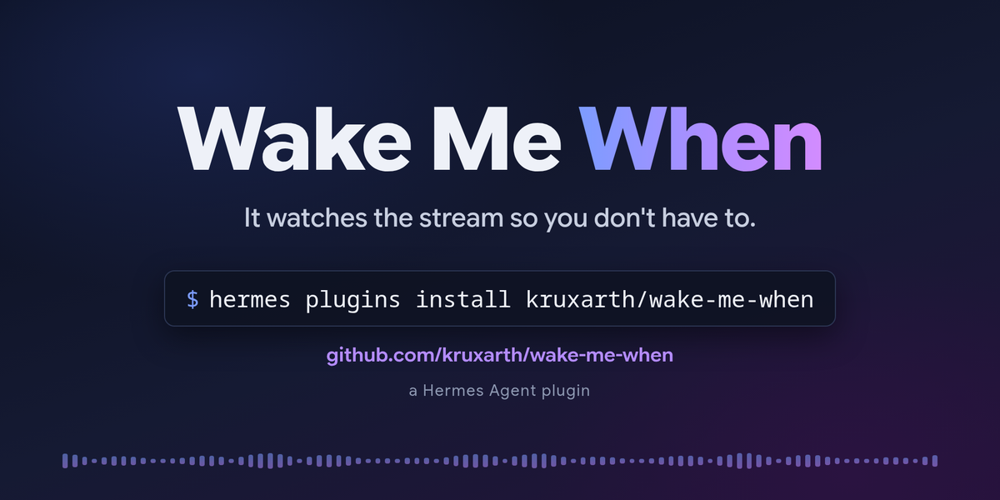
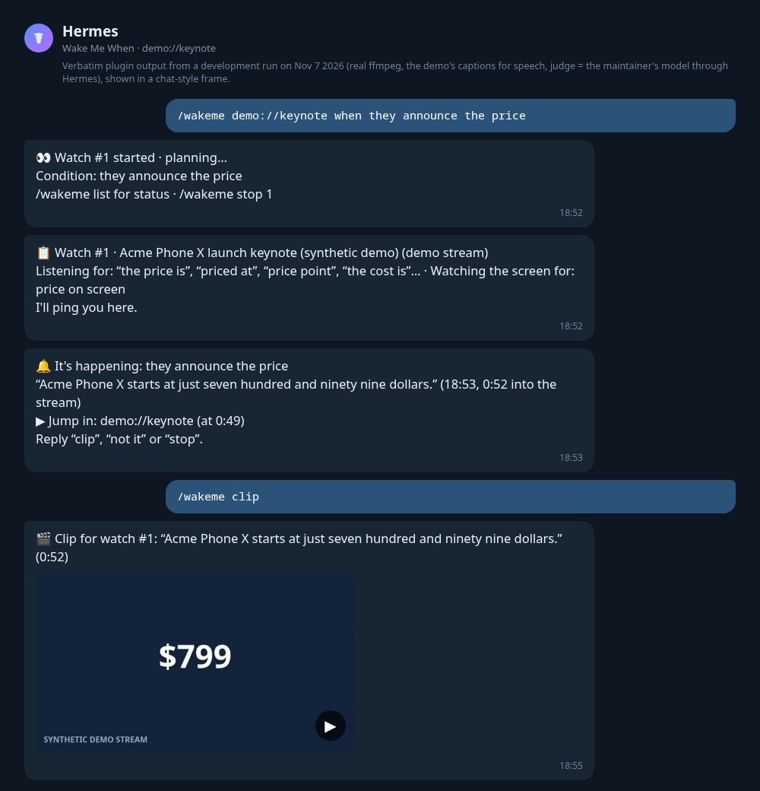
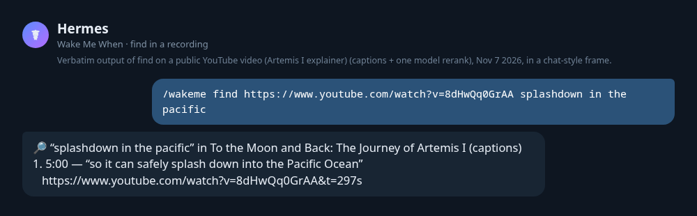

# Wake Me When

**Tell Hermes what you're waiting for in a live stream, and it pings you the moment it happens:
with the quote, a jump-in link, the clip, and a catch-up when you tune in.**



Keynotes, earnings calls, press conferences, Twitch streams, council meetings, rocket launches,
nature cams: most live audio and video has no feed and no alert. Wake Me When *listens* (local
speech recognition) and *looks* (on-screen text, optional vision model) and wakes you up only when
your moment arrives, in the chat you asked from (Telegram, Discord, Slack, …).

Real output from a development run (Nov 7 2026, judge = the maintainer's model through Hermes):

```
👀 Watch #3 started · planning…
Condition: they announce the price
/watching for status · /wakeme stop 3

📋 Watch #3 · Acme Phone X launch keynote (synthetic demo) (demo stream)
Listening for: "the price is", "pricing is", "we're pricing it at", "it will cost" · On-screen: "(?i)\b(price|pricing)\b\s*[:\-]?\s*\$?\s?\d", "(?i)\$\s?\d{1,3}([,.]\d{3})*(\.\d{2})?"
I'll ping you here.

🔔 It's happening: they announce the price
“Acme Phone X starts at just $799.” (14:18, 0:51 into the stream)
▶ Jump in: demo://keynote (at 0:48)
/wakeme clip 3 · /wakeme notit 3 · /wakeme stop 3
```



*Screenshots are the plugin's verbatim output from dev runs, shown in a chat-style frame.*

## 30-second quickstart

**Prerequisites:** Hermes ≥ 0.23.0 and `ffmpeg` on your PATH. For YouTube add
[`yt-dlp`](https://github.com/yt-dlp/yt-dlp), for Twitch [`streamlink`](https://streamlink.github.io),
for on-screen text `tesseract` (all optional):

```bash
uv tool install yt-dlp && uv tool install streamlink
```

**Install and check:**

```bash
hermes plugins install wake-me-when          # from the catalog (or: hermes plugins install kruxarth/wake-me-when)
hermes plugins enable wake-me-when
hermes wakeme doctor
```

`doctor` checks every tool, installs and warms speech recognition (Hermes's own `stt-whisper`
extra, one-time ~150 MB model download), runs a 20-second demo watch and prints a pass/fail report.

**Try it** (no network needed — the demo is a bundled synthetic keynote):

```
/wakeme demo://keynote when they announce the price
```

Add `?speed=4` to the demo link to run it four times faster. When the alert arrives, reply
**clip**, **not it** or **stop**; `/wakeme list` and `/wakeme catchup` show what's going on. Or just ask
the agent: *"wake me when the keynote gets to pricing https://youtube.com/…"*.

## Examples

| You say | What it listens / looks for |
|---|---|
| `/wakeme https://youtube.com/@acme/live when they announce the price` | "price", "starts at", "$799" spoken or on a slide |
| `/wakeme <earnings call link> when they give guidance for next quarter` | "guidance", "outlook", "we expect revenue" |
| `/wakeme https://twitch.tv/somestreamer when they reach the final boss` | the streamer saying it, chat-free (ads are skipped) |
| `/wakeme <council meeting stream> when agenda item 7 on the bike lane comes up` | "item seven", "bike lane", the agenda slide |
| `/wakeme <launch coverage> when it's T-minus 1 minute, or if it's scrubbed` | "T minus one minute", "scrub", "hold", "T-01:00" on screen |
| `/wakeme <nature cam> when a bear catches a fish` | a vision-model check on changed keyframes |
| `/wakeme https://twitch.tv/somestreamer every time they mention the giveaway` | each mention, at most one alert per 5 min ("…, at most every 10 minutes" changes that) |
| `/wakeme https://youtu.be/… where do they splash down` | a recording plus a question: ranked timestamps with deep links (`&t=…s`) |



"Every time …", "each time …" or "whenever …" keeps watching after the first alert, with a cooldown
(default 5 min). A recording link with a question ("where…", "what time…", "find…") searches it;
a live stream, or a condition starting with "when", is watched. `/wakeme find <url> <question>` always
searches.

## How it works

```
             ┌──────────── one ffmpeg per watch (+ streamlink for Twitch) ────────────┐
 stream ───► │ 16 kHz PCM ─► reader thread ─► audio ring (drops oldest, never blocks)  │
             │ keyframes every 2 s (only if the plan needs visuals)                   │
             │ 5 s segments, stream copy ─► ~3 min ring (clips)                       │
             └────────────────────────────────────────────────────────────────────────┘
 audio ring ─► 10 s windows, 2 s overlap ─► ONE shared faster-whisper worker (all watches)
                                              │ transcript rows (id, stream time, wall time)
                                              ▼
  Stage A  free   fuzzy + phonetic cue match, OCR regex on changed keyframes ──┐ hit → now
  Stage B  LLM    judge (aux task wakeme_judge): rows since max(2.5 min ago, last alert) ◄┘ or every 60 s
  Stage C  LLM    vision question on changed keyframes (aux task wakeme_vision, optional)
                                              │ {matched, confidence, evidence_row_ids}
                                              ▼
  confirm/debounce: ≥ 0.85 fires; otherwise a 2nd positive after newer speech · never re-fires on old evidence
                                              ▼
  🔔 alert (time from the rows, never from the model) · evidence segments copied out of the ring
     → reply "clip" any time later · rolling 10-min summaries → /wakeme catchup
```

- **One plan per watch.** A single structured call turns your condition into cue phrases (with
  speech-recognition misspellings), on-screen text patterns, an optional visual question, phrases
  that mean "not yet" ("we'll get to that in a moment") and whether you asked for every occurrence.
  The plan card shows the phrases and a plain label for the screen patterns, never the regexes.
- **The judge never invents times.** It cites transcript row ids; the plugin maps them to stream
  time and falls back to fuzzy-matching the quote.
- **"Not it" teaches it.** Replying *not it* (or `/wakeme wrong`) resumes the watch and shows the
  judge that moment as a negative example.
- **Budgets.** The periodic paraphrase check backs off from 60 s to 4 min while the stream stays
  clearly off-topic and snaps back on any cue hit. At most `max_llm_calls_per_hour` model calls per
  watch (default 60). When the
  budget runs out, or the provider is down, it keeps watching with Stage A only and fires on strong
  cue matches, clearly marked *unconfirmed* — it never misses silently.
- **Clips survive the ring.** At alert time the segments around the evidence are copied out of the
  rotating ring, so a *clip* reply minutes later still has the moment. The MP4 is cut on demand
  and attached as native video.

## Commands

| Command | What it does |
|---|---|
Everything is one command, `/wakeme`:

```
/wakeme <url> when <condition>     watch (say "every time …" for repeats)
/wakeme <recording url> <question> find the moment in a recording
/wakeme list · /wakeme catchup [id] · /wakeme clip [id] · /wakeme stop [id|all]
After an alert, just reply: clip · not it · stop      (/wakeme doctor checks setup)
```

| Command | What it does |
|---|---|
| `/wakeme <url> when <condition>` | Start a watch. Replies instantly; the plan follows. |
| `/wakeme <recording url> <question>` | Search a recording (YouTube, media link, local file); `/wakeme find <url> <question>` forces a search |
| `/wakeme list` | Watches, status (`planning`, `watching`, `behind`, `fired`, `stopped`, `ended`), uptime, alerts, model calls/h, missed alerts |
| `/wakeme catchup [id] [minutes]` | What happened since the start, the last alert, or the last N minutes |
| `/wakeme clip [id]` | The clip of the last alert (or the last 20 s if none) |
| `/wakeme stop [id\|all]` | Stop watches |
| `/wakeme doctor` · `hermes wakeme doctor` | Dependency check + 20 s demo watch |

The id is optional when one watch is running. After an alert, a plain reply works: *clip* sends the
video, *not it* (or *wrong*, *nope*) resumes the watch and learns from the miss, *stop* ends it.
Hermes doesn't let a plugin read chat messages, so the agent handles these: while a chat has watches,
the plugin adds a short note to your turn naming the watch that just alerted, and the agent calls the
matching tool. `/wakeme wrong [id] [why]` does the same as *not it* without the agent.

## Agent tools

`wakeme_watch`, `wakeme_find`, `wakeme_list`, `wakeme_stop`, `wakeme_catchup`, `wakeme_clip`,
`wakeme_feedback` — plus the bundled skill `wake-me-when:wake-me-when` that tells the agent when to
use each.

## Configuration

`plugins.entries.wake-me-when.settings.<key>` in `config.yaml`, or the gear on the plugin in the
Desktop Plugins tab.

| Key | Default | Meaning |
|---|---|---|
| `whisper_model` | `base` | `tiny`, `base` or `small` |
| `language` | `""` | speech language hint (`en`, …); empty = auto |
| `stt_backend` | `local` | `local` (faster-whisper) or `captions` (demo/sidecar captions only) |
| `max_watches` | `3` | live watches at once, across Hermes processes |
| `max_llm_calls_per_hour` | `60` | per watch |
| `semantic_check_sec` | `60` | periodic judge check for paraphrases (only when there's new speech) |
| `min_confidence` | `0.6` | lowest judge confidence that can fire |
| `watch_ttl_hours` | `6` | auto-stop |
| `feedback_grace_min` | `10` | how long a fired watch keeps its buffer for clip / not it |
| `clip_seconds` | `20` | clip length |
| `auto_clip` | `false` | cut the clip at alert time |
| `auto_attach_clip` | `true` | when `allow_gateway_injection` is granted, ask the agent to attach the clip right after an alert (one agent turn) |
| `catchup_summary_min` | `10` | minutes per rolling summary |
| `keep_transcripts_days` | `7` | transcripts and summaries |
| `keep_clips_days` | `2` | clips you asked for |
| `allow_private_network` | `false` | allow LAN addresses (local RTSP cameras) |
| `allowed_media_dirs` | `[]` | folders whose files may be watched from messaging chats |

Route the judge to a cheap/fast model with `hermes model` → *Configure auxiliary models* →
**Wake Me When judge**, or in `config.yaml`:

```yaml
auxiliary:
  wakeme_judge: {provider: openrouter, model: some/fast-model, reasoning_effort: none}
```

The vision stage has its own slot (**Wake Me When vision**, inherits your vision model), so a
text-only judge never breaks it.

## Expected latency

Time from the moment being said to the alert ≈ source delay + up to 10 s transcript window +
speech recognition (~0.5 s for `base` on a laptop CPU) + one judge call (4–8 s with a typical hosted
model), plus one more judge round when the plan asks for confirmation (`confirm: twice`).

Measured on Nov 7 2026 ([TESTING.md](TESTING.md) has the breakdown):

| Run | Moment → alert |
|---|---|
| `demo://keynote`, stub model (instant judge) | 6.5 s |
| `demo://keynote`, real model, plan chose `confirm: twice` | ~25 s (3 judge calls of ~4 s) |
| Twitch live (summit1g), real model, `confirm: twice` | 18 s after the transcript row, ~33 s after the words; add the source delay below |

| Source | Typical source delay (stream behind real life) |
|---|---|
| `demo://` / local file | 0 |
| Twitch | ~5–10 s behind live |
| YouTube Live | ~15–30 s behind live |
| RTSP camera | ~1–3 s |

## Limitations

- DRM-protected streams (Netflix, most paid sports) are not supported. You are responsible for
  having the rights to what you watch and clip.
- YouTube is the flakiest source: it rate-limits caption fetches (HTTP 429) and sometimes asks to
  sign in. The plugin says so clearly and never reads browser cookies. `find` falls back to local
  speech recognition when captions are refused.
- A watch lives in the Hermes gateway process. Restarting the gateway stops it (it shows as
  `stopped (gateway restart)` in `/wakeme list`).
- In the classic `hermes chat` CLI, Hermes doesn't display plugin messages, so alerts there show up
  in `/wakeme list` ("Alerts you may have missed"). Telegram/Discord/Slack, the TUI and Desktop show them
  live.
- Audio-only sources produce audio-only clips.
- A moment that none of the plan's cue phrases or on-screen patterns catch waits for the periodic
  judge check. That runs every `semantic_check_sec` and backs off to every 4 min on a quiet watch, so such
  alerts can be minutes late. Phrase the condition with the words you expect to hear.

## Troubleshooting

- **Run `hermes wakeme doctor` first.** Every failed check prints the exact install command.
- *"installing speech recognition"*: the first real watch installs Hermes's `stt-whisper` extra and
  downloads the model; `doctor` does this up front. If it says to restart, run `hermes gateway restart`.
- *`behind` in /wakeme list*: speech recognition can't keep up (too many watches or `small` on a slow
  CPU). Use `whisper_model: base` or fewer watches; audio is dropped oldest-first, ingest never stalls.
- *YouTube: "Sign in to confirm you're not a bot" / 429*: wait a few minutes or use another source.
  Installing Deno (or having node/bun) helps yt-dlp read every format.
- *Twitch: "offline"*: the channel isn't live; `streamlink --json twitch.tv/<name>` confirms.

## Disclosure

- **Network calls:** to the stream hosts you give it, through `yt-dlp`, `streamlink` and `ffmpeg`
  (and `ffprobe`); a one-time download of the Whisper model from Hugging Face; Hermes's own package
  index when it installs the `stt-whisper` extra. No other hosts.
- **External tools it runs:** `ffmpeg`/`ffprobe` (required), `yt-dlp`, `streamlink`, `tesseract`, and
  a JavaScript runtime (Deno, node or bun) that yt-dlp may use for YouTube. None are bundled; all are
  detected at runtime. Every subprocess uses an argv list (never a shell), `--` before user URLs, and
  an explicit ffmpeg `-protocol_whitelist` per source type (network and `file` protocols are never
  mixed).
- **Long-running processes:** one `ffmpeg` per active watch (plus one `streamlink` for Twitch), in
  their own process group, killed on stop, plugin unload and gateway exit; one shared
  speech-recognition worker thread.
- **Local files:** accepted only from the Hermes CLI/TUI/Desktop or from folders you list in
  `allowed_media_dirs`; refused from messaging chats.
- **Data sent to your model:** transcript excerpts, on-screen text and (only when a watch has a visual
  question) keyframes, via Hermes's `ctx.llm` with your configured provider.
- **Local storage** under `<hermes home>/plugin-data/wake-me-when/`: a 3-minute rolling media buffer
  per watch (deleted when the watch ends, after the grace window), clips you ask for (kept
  `keep_clips_days`), transcripts and summaries (kept `keep_transcripts_days`).
- **Optional permission:** `plugins.entries.wake-me-when.allow_gateway_injection: true` lets the
  plugin (a) ask the agent in your chat to attach the clip right after an alert (`auto_attach_clip`),
  which runs one agent turn on your main model, and (b) hand an alert it couldn't post to the agent.
  Off by default; without it, `/wakeme clip <id>` is the way to get the clip.
- **No telemetry.** Nothing is reported anywhere.
- **Speech recognition install:** on first use (or `doctor`) it asks Hermes to install its own
  `stt-whisper` extra (`faster-whisper`) through Hermes's package manager.

## License

MIT. The demo streams in `assets/demo/` are original: scripts written for this plugin, speech
synthesised with edge-tts, slides drawn by ffmpeg (`scripts/make_demo_assets.py`).
